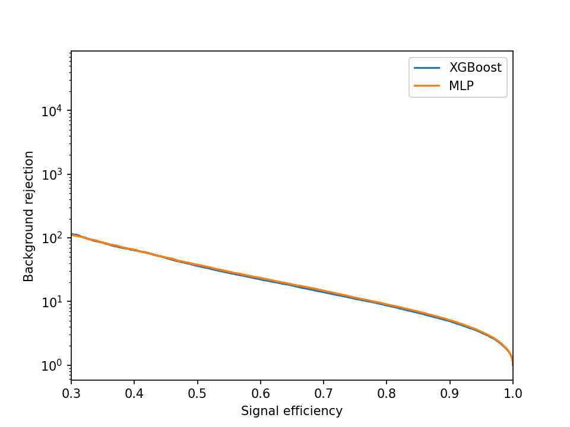
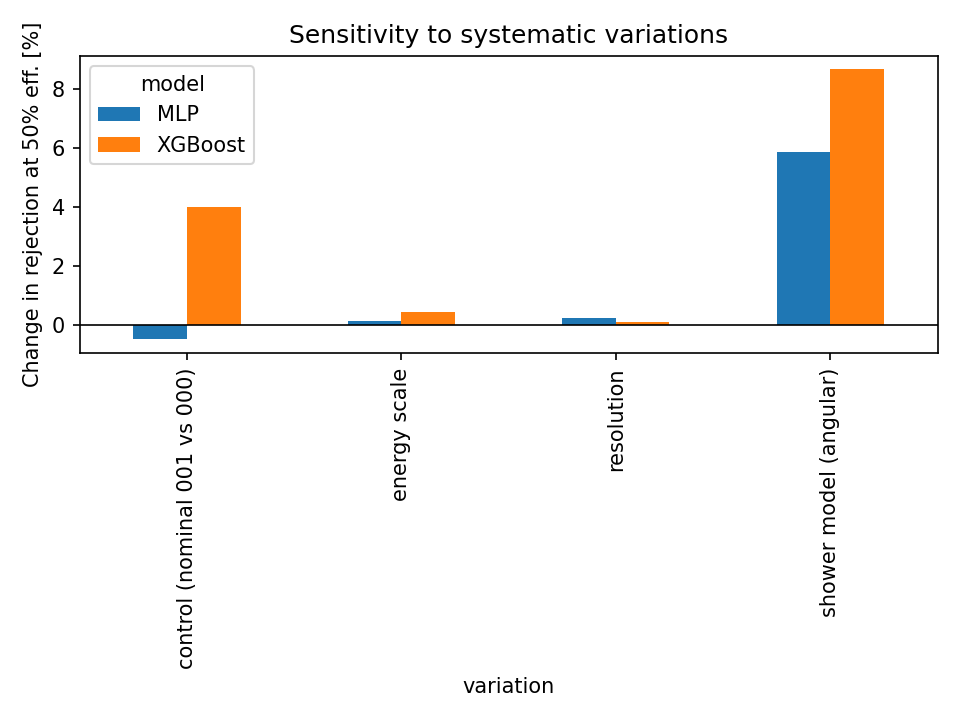

## Data

All the data comes from the [ATLAS Top Tagging Open Data Set](https://opendata.cern.ch/record/80030), which CERN released publicly in 2024. It's simulated, so every jet comes with a label saying whether it really came from a top quark or not. That label is exactly what's missing from real collision data. ATLAS describe how the dataset was made in [their paper](https://arxiv.org/abs/2407.20127).

The full dataset is huge (over 900 training files), so I worked with a small slice of it:

| File | What I used it for |
|---|---|
| `train_nominal_000` | Training (80%) and validation (20%), about 100,000 jets |
| `test_nominal_000` | Testing both models, about 100,000 jets |
| `test_nominal_001` | A second test file, to measure how much the results move by chance |
| `esup`, `esdown`, `cer`, `angular` | The varied simulations used in the robustness test |

### The features

Each jet comes with 15 numbers that describe its shape on the inside, called its **substructure**. This is where the physics is. A top quark decays into three quarks, so a top jet usually has **three clumps of energy** inside it, while a background jet usually has just one. The features measure this in different ways:

| Features | What they measure, roughly |
|---|---|
| `fjet_ECF1`, `fjet_ECF2`, `fjet_ECF3`, `fjet_C2`, `fjet_D2`, `fjet_L2`, `fjet_L3` | How the jet's energy is shared out between pairs and triples of particles. Ratios such as D2 are good at telling one-clump jets from multi-clump jets. |
| `fjet_Tau1_wta` … `fjet_Tau4_wta` | How well the jet fits 1, 2, 3 or 4 clumps. A top jet fits three clumps much better than one. |
| `fjet_Split12`, `fjet_Split23` | How much energy it takes to split the jet into 2 clumps, then into 3. |
| `fjet_Qw` | The mass of the most W-boson-like pair of clumps. A top quark decays via a W boson, so top jets often have a pair with about the W mass. |
| `fjet_ThrustMaj` | How "pencil-like" or spread out the jet is. |

### What I left out
- **`fjet_pt`, `fjet_eta` and `fjet_phi`** describe how fast the jet is going and in which direction, not its shape. I wanted both models to learn what a top jet *looks like inside*, not where it happened to go.
- **`EventInfo_mcEventNumber`** is just an ID number for each simulated collision. I only used it to check which files contain the same jets.
- **`fjet_m`**, the jet's mass, is very powerful, but I kept it out so the models rely on the substructure. Adding it back is an easy extra experiment.

Each training jet also has a **training weight**, and the dataset asks for these to be used during training, so both models use them. The test files don't have weights, so every test jet counts equally.

## Method
### XGBoost baseline (notebooks/02_XGboost.ipynb)

XGBoost builds lots of small decision trees one after another. Each new tree focuses on the jets the previous trees got wrong.

- Each tree can be at most 4 questions deep (`max_depth=4`), and the learning rate is 0.1.
- It's allowed up to 1000 trees, but it stops once the validation score hasn't improved for 50 trees. It ended up using 528.
- Each jet's training weight is used, in both training and validation.
- A **SHAP** plot shows which features the model leans on most, and in which direction each one pushes a jet (towards "top" or towards "background").

### Neural network (notebooks/03_mlp.ipynb)

The neural network is a small **multi-layer perceptron**. The 15 features go in, pass through 3 layers of 64 neurons, and one number comes out, which is turned into a probability between 0 and 1. It has about 9,400 adjustable weights in total. The model is defined in `src/models.py`.

- **Scaling first.** Unlike trees, neural networks care about the size of the numbers they're given, and some of these features are in the millions while others sit between 0 and 1. A `QuantileTransformer` reshapes every feature into a bell curve first. It learns how to do this from the training data only, and the same scaling is then reused on every other file.
- **Training.** Weighted binary cross-entropy loss (the same loss XGBoost uses), the Adam optimiser with a learning rate of 0.001, and batches of 1024 jets.
- **Dropout** switches off a random 10% of neurons during training, which stops the network from memorising the training jets.
- **Early stopping.** Training stops once the validation loss hasn't improved for 5 epochs, and the best version is kept. It stopped after 55 epochs.
- **A fair fight.** Both models use exactly the same training jets, features and train/validation split (`random_state=1`), so any difference comes from the model, not the data.



*Background rejection against signal efficiency for both models. Higher is better.*

### Robustness test (notebooks/04_robustness.ipynb)

Neither model is retrained here. The trained models are simply run on simulations where one thing has been changed, and I measure how much the background rejection moves.

| Variation | What's changed | Type |
|---|---|---|
| `esup` / `esdown` | The detector's energy scale is shifted up / down, as if it read slightly high or low | Detector |
| `cer` | The detector's energy resolution is changed | Detector |
| `angular` | A different parton-shower model is used, which changes how the inside of the jet is simulated | Physics simulation |

Getting a fair comparison turned out to be the trickiest part of the project. My first results showed XGBoost's rejection jumping by 5–6% under every detector variation, while the neural network barely moved. That looked like an exciting result, until I checked which jets were in each file:

- **`esup`, `esdown` and `cer` all contain the same collisions as each other, but different ones from the test file.** So comparing them with the test file mixed up two things: the detector change, and simply having different jets. Comparing them **with each other** removes the second effect:
    - The energy-scale effect is half the difference between `esup` and `esdown`.
    - The resolution effect is `cer` compared with the average of `esup` and `esdown`.
- **`angular` shares no jets with any other file**, so there's no perfect comparison for it. To see how much rejection moves just from using a different set of jets, I ran both models on a second nominal test file (`test_nominal_001`). This is the **control**. Then `angular` is compared with the average of the two nominal files.

Once the comparisons were fair, the detector effects shrank to under half a percent for both models.



## Results in detail

**On the nominal test file (`test_nominal_000`)**

| Model | AUC | R50 | R80 |
|---|---|---|---|
| XGBoost | 0.926 | 36.3 | 8.6 |
| MLP | 0.929 | 37.7 | 9.0 |

(AUC is the chance that a random top jet scores higher than a random background jet, where 1 is perfect. R80 is the background rejection at 80% signal efficiency.)

**Change in background rejection under each variation**

| Comparison | XGBoost at 50% | MLP at 50% | XGBoost at 80% | MLP at 80% |
|---|---|---|---|---|
| Energy scale (half of up − down) | 0.44% | 0.16% | 0.28% | 0.21% |
| Energy resolution (`cer` vs up/down average) | 0.12% | 0.24% | 0.11% | 0.16% |
| **Control:** second nominal file vs first | +4.00% | −0.47% | −1.00% | −1.74% |
| Shower model (`angular` vs nominal average) | +8.66% | +5.87% | +7.27% | +5.72% |

The notebook saves this table as `robustness_corrected.csv`.

### What this means

- **The neural network is slightly more accurate.** It lets through about 4% less background than XGBoost at the same signal efficiency, and its AUC is a little higher.
- **The detector variations hardly matter.** Shifting the energy scale or the resolution changes rejection by less than half a percent for both models.
- **The shower model is by far the biggest effect.** Changing how the jet's insides are simulated moves rejection by 6–9%, more than ten times the detector effects. This is exactly the worry from the start: if the simulation of jet substructure is slightly off, a substructure-based tagger's performance changes with it.
- **Rejection going *up* isn't good news.** On the `angular` sample both taggers rejected *more* background. That doesn't mean they got better. It means their performance depends on which simulation you believe, and in a real analysis that becomes an uncertainty on the result.
- **So, does accuracy cost robustness here? No sign of it.** The more accurate model (the neural network) also moved less under the shower model. But the gap (about 3 percentage points at 50%, 1.5 at 80%) is about the same size as the control's movement, which was up to 4%. So I can't honestly claim it's more robust, only that being more accurate didn't make it *less* robust.

## Limitations

- **A small slice of the data.** About 100,000 training jets and one test file, out of a dataset with hundreds of files. The control shows results move by a few percent just from using different jets, and more data would shrink that.
- **The noise estimate comes from one pair of files.** A proper error bar on every number (for example by bootstrapping: re-sampling the test jets many times and seeing how much the result moves) would make the comparisons much clearer.
- **One training run per model.** Retraining the neural network with different random starting weights would show how much its results depend on luck.
- **Only four variations.** The dataset includes many more detector and simulation variations, and each one is one extra line in `04_robustness.ipynb`.

## Repository layout

```
notebooks/
  01_explore_data.ipynb   # loading the data and first physics plots
  02_XGboost.ipynb        # XGBoost baseline, ROC curve, SHAP
  03_mlp.ipynb            # neural network, and comparison with XGBoost
  04_robustness.ipynb     # robustness test and corrected comparisons
src/
  data.py                 # loading the files, feature list
  metrics.py              # background rejection at a fixed signal efficiency
  models.py               # the neural network (TopTaggerMLP)
plots/                    # figures used in this README
```

## How to rerun

Everything runs in Google Colab on the free tier. Switching on a GPU (Runtime → Change runtime type → T4 GPU) makes the neural network train faster.

1. Open the notebooks in Colab using the "Open in Colab" badge at the top of each one. Each notebook mounts Google Drive, clones this repo and imports the code in `src/`.
2. The notebooks download the data files they need from the [CERN Open Data Portal](https://opendata.cern.ch/record/80030) into a Drive folder called `cern_data/`, using `cernopendata-client`, `wget` and `gunzip`.
3. Run them in order: **02 → 03 → 04**. Notebooks 02 and 03 save the trained models, the scaler and the test scores to Drive, and notebook 04 loads them.

Python packages used: `numpy`, `pandas`, `h5py`, `scikit-learn`, `xgboost`, `shap`, `torch`, `matplotlib`, `joblib`, `cernopendata-client`.

## References

- ATLAS Collaboration, *Accuracy versus precision in boosted top tagging with the ATLAS detector*, [arXiv:2407.20127](https://arxiv.org/abs/2407.20127).
- ATLAS Top Tagging Open Data Set, [CERN Open Data Portal, record 80030](https://opendata.cern.ch/record/80030).
- Example code for loading the dataset: [gitlab.cern.ch/atlas/ATLAS-top-tagging-open-data](https://gitlab.cern.ch/atlas/ATLAS-top-tagging-open-data).
